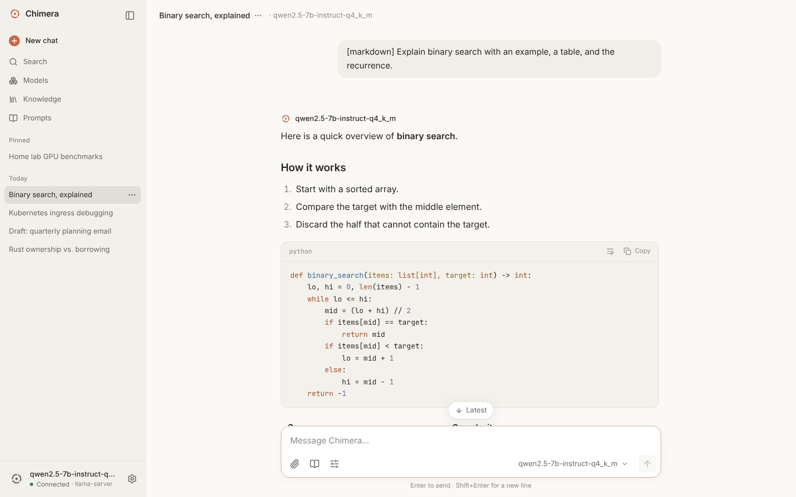
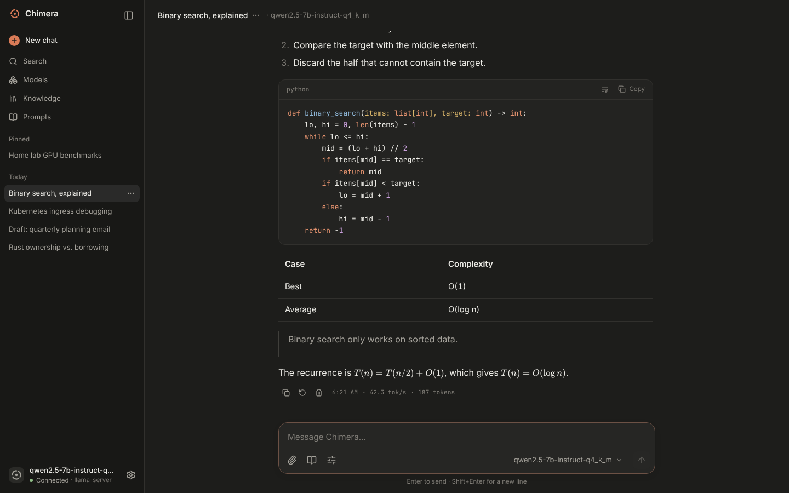
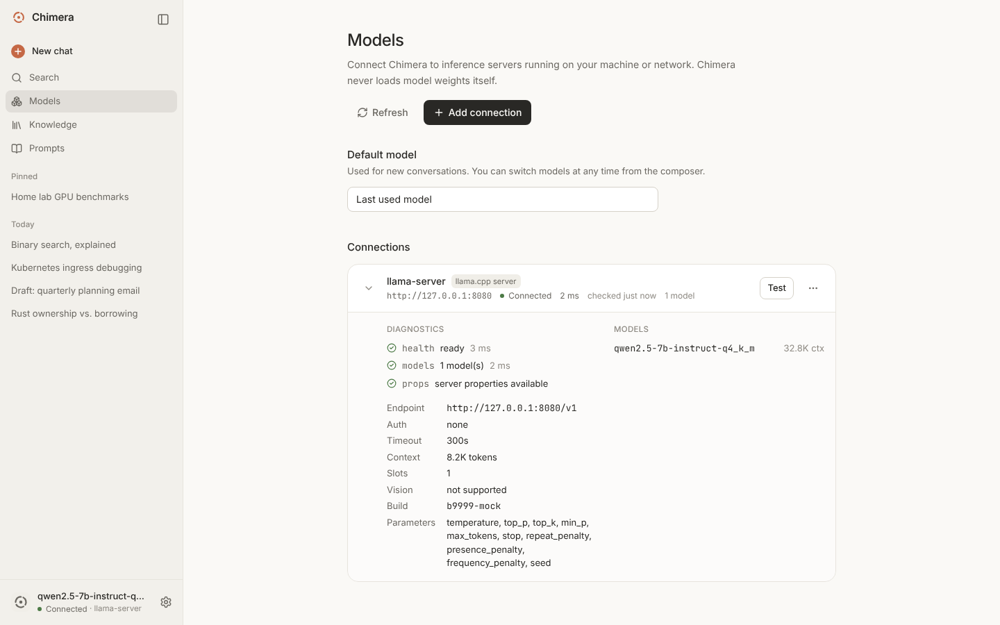

# Chimera

A minimalist, self-hosted AI chat workspace for **your own local language models**.
Chimera pairs a calm, editorial interface with first-class support for
[llama.cpp](https://github.com/ggml-org/llama.cpp)'s `llama-server`, plus Ollama
and any OpenAI-compatible server. Everything (conversations, documents,
settings) stays on your machine.



- **Local-first** – built around `llama-server`; no cloud account, API key or internet connection required.
- **Private** – no telemetry, no analytics, no CDN. The UI ships its own fonts and assets.
- **Offline-capable** – after installation, nothing is fetched from the internet unless an administrator turns on web access.
- **Web-aware when you want it** – paste a link and the model reads the page; turn on search for a message and it answers with citations (self-hosted SearXNG recommended).
- **Calm** – a warm, restrained design that stays readable during long technical sessions.
- **Multi-user** – accounts with private data per person; shareable connections for a household or team.
- **English and Lithuanian** – switch instantly, before or after signing in.

> Chimera is the **interface**, not the inference engine. It does not load model
> weights. You run `llama-server` (or Ollama, LM Studio, vLLM…) and Chimera talks
> to it over HTTP.

---

## Contents

- [Quick start](#quick-start)
- [First run: accounts](#first-run-accounts)
- [Connect to llama-server](#connect-to-llama-server)
- [Features](#features)
- [Configuration](#configuration)
- [Security model](#security-model)
- [Testing](#testing)
- [Project layout](#project-layout)
- [Status and limitations](#status-and-limitations)
- Further docs: [llama-server guide](docs/LLAMA_SERVER.md) · [web reading & search](docs/WEB.md) ·
  [Deployment, updates & backups](docs/DEPLOYMENT.md) ·
  [Reverse proxies](docs/REVERSE_PROXY.md) ·
  [Security & privacy](docs/SECURITY.md) ·
  [Endpoint audit](docs/ENDPOINT_AUDIT.md) ·
  [Localization](docs/I18N.md) ·
  [Architecture](docs/ARCHITECTURE.md) ·
  [Troubleshooting](docs/TROUBLESHOOTING.md) ·
  [Changelog](CHANGELOG.md) · [Contributing](CONTRIBUTING.md) · [Releasing](RELEASING.md)

## Quick start

### Option A: Docker with the published images (recommended)

On a Linux server with Docker and Compose v2:

```bash
curl -fsSLO https://github.com/Riloative/chimera/releases/latest/download/install-docker.sh
less install-docker.sh               # read it first
sudo bash install-docker.sh          # asks about web search and the headless browser
```

It installs into `/opt/chimera`, verifies the downloaded files against the
release checksums, generates the secrets, pulls the signed multi-architecture
images (`ghcr.io/riloative/chimera`, amd64 and arm64), starts the stack and
prints the address. Nothing is built locally. The manual steps (without the
script), profiles and options are in [Deployment](docs/DEPLOYMENT.md#install-with-docker).

Open <http://127.0.0.1:8700> on the server, or from your computer through an
SSH tunnel (`ssh -L 8700:127.0.0.1:8700 your-server`). The port listens on
`127.0.0.1` only; for access from other devices put HTTPS in front
([reverse proxies](docs/REVERSE_PROXY.md)).

On first start Chimera creates a connection to `llama-server` on the host
(`http://host.docker.internal:8080`). On Linux, llama-server must be reachable
from the container; the options (Docker bridge address, a socket proxy, or
llama-server in the `llama` profile) are in
[Deployment → llama-server on the same host](docs/DEPLOYMENT.md#llama-server-on-the-same-host).

**Updating** is one command with a backup, a health check and automatic
rollback: `sudo /opt/chimera/update.sh` ([details](docs/DEPLOYMENT.md#updating);
opt-in [automatic updates](docs/DEPLOYMENT.md#automatic-updates)).

### Option B: Native install (Linux / macOS / WSL)

Requirements: Python 3.11+, Node.js 22 (only to build the UI once).

```bash
git clone https://github.com/Riloative/chimera.git && cd chimera
git checkout v1.0.0      # a release tag (main is the development branch)
./scripts/install.sh     # builds the UI, creates backend/.venv
./scripts/start.sh       # serves on http://127.0.0.1:8700
```

<details>
<summary>Manual steps (e.g. Windows without WSL)</summary>

```bash
cd frontend && npm ci && npm run build && cd ..
python -m venv backend/.venv
backend/.venv/Scripts/pip install -e backend        # bin/ on Linux/macOS
set CHIMERA_STATIC_DIR=%CD%\frontend\dist             # export … on Linux/macOS
backend/.venv/Scripts/chimera
```
</details>

### Option C: Build the images yourself

```bash
git clone https://github.com/Riloative/chimera.git && cd chimera
docker compose -f docker-compose.yml -f docker-compose.dev.yml up -d --build
```

### Try it without a model

A mock `llama-server` is included for development and demos:

```bash
backend/.venv/bin/python backend/tests/mock_llama_server.py --port 8080
```

## First run: accounts

Everything in Chimera requires an account.

1. Open the app. With no accounts yet you'll see **Set up Chimera**: the first
   account (email, login name, password) becomes the **administrator**.
2. By default (`CHIMERA_REGISTRATION_MODE=first_user_only`) self-registration
   then closes. Add people in **Settings → Users**, or switch the mode to
   *Open* (anyone who can reach the app may register) or *Closed*.
3. Sign in later with either your email or your login name.

Each user sees only their own conversations, prompts, knowledge, attachments
and settings. Administrators can mark a connection as **shared** so everyone can
use one llama-server; the default connection created at setup is shared.

**Forgot a password?** No email is involved: an administrator resets it in
Settings → Users (a temporary password that must be changed at next sign-in), or
on the server run `chimera reset-password <login>` (Docker:
`docker compose exec chimera chimera reset-password <login>`).

**Upgrading from 0.1?** Your data is kept: a backup is written to
`data/backups/` before the database is migrated, and the first account you
register adopts all existing conversations, prompts, settings and connections
(a one-time notice lists them). Coming from a locally built 0.x Docker
install: [moving to the published images](docs/DEPLOYMENT.md#moving-a-locally-built-0x-install-to-the-published-images).

## Connect to llama-server

1. **Start llama-server** with any GGUF model:

   ```bash
   llama-server -m ~/models/qwen2.5-7b-instruct-q4_k_m.gguf \
     --host 127.0.0.1 --port 8080 -c 8192 --jinja
   ```

   Useful extras: `--api-key <key>` (then enter the key in Chimera),
   `--mmproj <file>` for vision models, `--embeddings` to use it for the
   knowledge base, `-ngl 99` to offload layers to the GPU.

2. **Add the connection** – open **Models → Add connection**, keep the type
   *llama.cpp server*, set the URL (`http://127.0.0.1:8080`, or
   `http://host.docker.internal:8080` from Docker), and click **Test connection**.
   You'll see health, model list, context size, slot count, vision support and the
   server build.

3. **Chat** – pick the model in the composer and start typing.

Run several servers (general, coding, reasoning, vision) and add each as its own
connection; the model picker groups models by connection and shows which are
reachable. See the [llama-server guide](docs/LLAMA_SERVER.md) for the exact API
surface used, multi-server setups, embeddings and vision.

## Features

| Area | What works today |
| --- | --- |
| **Chat** | Token streaming, stop, regenerate, edit & resubmit, retry failed responses, delete messages, copy message / code, reasoning ("thinking") display, per-message tokens/s, smart autoscroll with *jump to latest* |
| **Branching** | Editing a message or regenerating an answer keeps the old version as a branch; an inline `‹ 2 / 3 ›` navigator switches between versions, the chosen path is stored per conversation, search jumps to the branch a hit is on, export/import keeps the whole tree |
| **Context window** | Window size read from llama-server per slot (or set per connection); exact token counts via `/tokenize`; system prompt → latest message (with pages) → pinned messages → recent history in whole exchanges; leave-out (default), summarize or off; prompt-cache-friendly trimming; one tighter retry when the server still rejects; a usage indicator, a marker where history stops being sent, and pinning |
| **Rendering** | GitHub-flavored Markdown, tables, task lists, syntax highlighting, KaTeX math (`$…$`, `$$…$$`, `\(…\)`, `\[…\]`), safe links; raw HTML and remote images are never rendered |
| **Models** | Multiple connections (llama-server, OpenAI-compatible, Ollama), live discovery, cached last-known list, manual model IDs, per-connection timeout / API key / custom auth header / API path, honest status (*Not tested / Connected / Unreachable*), diagnostics view |
| **Resilience** | Generations run server-side: closing or reloading the tab doesn't lose an answer, the UI re-attaches to the live stream. Interrupted generations are marked as such after a restart; nothing stays stuck "loading" |
| **Conversations** | SQLite persistence, Today / Yesterday / 7 / 30 days / Older grouping, pin, rename, delete, full-text search of titles and content, model-generated titles with fallback, Markdown export |
| **Parameters** | Temperature, top-p, top-k, min-p, max tokens, stop sequences, repeat / presence / frequency penalty, seed: as global defaults and per conversation. Only parameters the connection supports are sent |
| **Attachments** | Text, Markdown, source code, JSON/CSV, PDF (text extraction). Images for vision-capable models only. Size limits, type sniffing, truncation notice, preview of what the model receives |
| **Knowledge (RAG)** | Local collections, chunking, SQLite FTS5 keyword search out of the box, optional local embeddings for hybrid semantic search, retrieval test bench, sources shown under answers |
| **Web** | Off by default. Pasted links are read (HTML → clean Markdown, PDF, JSON, CSV, RSS, GitHub raw files) with per-link status; per-message web search via SearXNG, Brave or Tavily with live steps, inline citations and a sources list; BM25 passage selection within the model's context budget; SSRF-hardened fetcher, prompt-injection delimiting, per-user quotas; optional isolated headless browser for JavaScript pages (automatic or "Render with browser"). See [docs/WEB.md](docs/WEB.md) |
| **Prompts** | Library with categories, insert into composer, use as a conversation's system prompt |
| **Settings** | Light / dark / system theme, font size, conversation width, reduced motion, sidebar, Enter-to-send, streaming, auto titles, default system prompt & parameters, attachment limits, embedding model |
| **Data** | JSON export / import, one-click SQLite backup / restore, `chimera backup` / `restore` archives (database, uploads, keys), delete all conversations or all data |
| **Operations** | Published, signed multi-arch images; install script with checksum verification; `update.sh` with backup, health check and automatic rollback; opt-in automatic updates (systemd timer) and in-app update notices for admins; downgrade guard; readiness endpoint; startup configuration validation; JSON logs; hardened containers |
| **Accounts** | Registration modes, Argon2id passwords, server-side revocable sessions (idle + absolute expiry, remember me), CSRF tokens, login throttling, session list, password change, admin user management, password reset without email, account deletion, per-user export |
| **Isolation** | Every record is owned by a user and every endpoint is scoped (404 across users); personal and admin-shared connections; API keys encrypted at rest; SSRF policy for user-entered URLs |
| **Languages** | English and Lithuanian (UI, errors, dates, numbers, plurals); language stored per account; typed translation keys and parity checks |
| **Access** | Loopback by default, DNS-rebinding and origin checks, trusted-proxy support, opt-in CORS, strict CSP |
| **Keyboard** | `Ctrl/⌘ K` search, `Ctrl/⌘ ⇧ O` new chat, `Ctrl/⌘ B` sidebar, `Esc` stop, `Enter` / `Shift+Enter` |

<p align="center">
  
  
</p>

## Configuration

All configuration that affects security or storage is done through environment
variables (or a `.env` file in the working directory); everything else lives in
**Settings** in the UI. See [`.env.example`](.env.example) for the full list.

| Variable | Default | Purpose |
| --- | --- | --- |
| `CHIMERA_HOST` | `127.0.0.1` | Bind address |
| `CHIMERA_PORT` | `8700` | Port |
| `CHIMERA_DATA_DIR` | `./data` | SQLite database, uploads, session key |
| `CHIMERA_REGISTRATION_MODE` | `first_user_only` | `first_user_only`, `closed` or `open` (admins can change it in the UI) |
| `CHIMERA_SETUP_TOKEN` | *(unset)* | Required to create the first account, if set |
| `CHIMERA_ALLOWED_HOSTS` | loopback names | Host header allow-list (`*` disables it) |
| `CHIMERA_TRUSTED_PROXIES` | *(none)* | Proxies whose `X-Forwarded-*` headers are honoured |
| `CHIMERA_SESSION_IDLE_HOURS` / `_ABSOLUTE_HOURS` / `_REMEMBER_DAYS` | 12 / 168 / 30 | Session lifetimes |
| `CHIMERA_COOKIE_SECURE` | `auto` | `Secure` cookie flag (`auto` = when served over HTTPS) |
| `CHIMERA_LOGIN_MAX_FAILURES` etc. | 5 / 15 min / 60 s | Brute-force lockout |
| `CHIMERA_ENCRYPTION_KEY` | generated file | Key for API keys at rest |
| `CHIMERA_CORS_ORIGINS` | *(none)* | Extra origins allowed to call the API |
| `CHIMERA_SEED_PROVIDER_URL` | `http://127.0.0.1:8080` | Connection created on first start |
| `CHIMERA_HTTP_TRUST_ENV` | `false` | Use `HTTP(S)_PROXY` for provider requests |

## Security model

- **Same machine (default):** binds to `127.0.0.1`; accounts are required; the
  Host header must be a loopback name (DNS rebinding) and every state-changing
  request needs a session-bound CSRF token.
- **Trusted LAN:** bind `0.0.0.0` and list your hostname/IP in
  `CHIMERA_ALLOWED_HOSTS`. Plain HTTP exposes passwords and cookies to anyone
  who can watch the network; prefer HTTPS.
- **Remote / internet:** HTTPS reverse proxy, `CHIMERA_TRUSTED_PROXIES`,
  `CHIMERA_COOKIE_SECURE=true`, registration closed, ideally behind a VPN.
  Never expose `llama-server` itself.

Passwords are hashed with Argon2id; sessions are server-side and revocable;
login attempts are throttled per account and per IP; API keys are encrypted at
rest and never returned to the browser; model output is rendered without raw
HTML. Details: [docs/SECURITY.md](docs/SECURITY.md) and the
[endpoint audit](docs/ENDPOINT_AUDIT.md).

## Testing

No model, GPU or internet access is needed: integration tests use the mock
OpenAI-compatible/llama-server in `backend/tests/mock_llama_server.py`.

```bash
./scripts/test.sh                 # everything
backend/.venv/bin/python -m pytest backend/tests          # backend
cd frontend && npx tsc -b && npx eslint . && npx vitest run   # frontend typecheck, lint, unit + localization tests
cd frontend && npx playwright test   # end-to-end in Chromium
```

CI (`.github/workflows/ci.yml`) runs all of this on every pull request, plus
both Docker builds, `actionlint`, `shellcheck`, Compose validation and the
version-consistency check.

The suites cover startup, provider configuration and diagnostics, connection
failure and recovery, model discovery and caching, streaming (including split
chunks, malformed events, truncated streams and mid-stream errors),
cancellation (verifying the upstream connection is closed), re-attaching after a
disconnect, persistence across restarts, edit/regenerate, Markdown/code
rendering and sanitization, settings persistence, attachment validation, RAG,
export/import/backup/restore, offline operation (all external requests blocked),
security-sensitive endpoints (CSRF, DNS rebinding, origin checks, secret
handling), and accounts: registration modes, login by email or name, generic
errors and timing, lockout, session expiry/rotation/revocation, an enumeration
test proving every API route rejects anonymous requests, cross-user isolation
for every resource type, account deletion, and migrating a 0.1 database. Web
features are tested against a local mock web (`backend/tests/mock_web.py`:
realistic and hostile pages, failures, SearXNG/Brave/Tavily-compatible
engines), including a table of hostile URLs for the SSRF validator, DNS
rebinding, redirects to internal addresses, size and decompression limits,
prompt-injection fixtures, cancellation at every stage and cross-user isolation.
Branching tests cover the migration of linear history, edit/regenerate
siblings, switching while streaming, subtree deletion, search and export/import
of trees. Context tests drive the mock's `/props`, `/tokenize`,
`/apply-template` and exact overflow errors (window discovery, exact counting,
budget order, hysteresis, summaries, retries). The headless browser is tested
through its egress proxy (SSRF table, DNS pinning, credentials, limits) with a
fake service, and — when a Python with Playwright is available
(`browser/.venv`, see [browser/README.md](browser/README.md)) — with the real
service and real Chromium (rendering, internal targets from page scripts,
redirects, downloads, clean profiles, timeouts, cancellation without orphaned
processes).
Localization tests check catalog parity (keys, plural forms, placeholders),
Lithuanian plurals, `Intl` formatting, localized error codes, instant language
switching and a scan for hardcoded strings; an end-to-end test covers register →
switch to Lithuanian → reload → sign out → sign in → streaming chat.

## Project layout

```
backend/
  chimera/
    providers/     provider abstraction + llama.cpp, OpenAI-compatible, Ollama adapters, SSE parser
    web/           hardened fetcher, extraction, search engines, ranking, web-grounded pipeline,
                   browser client and its egress filter proxy
    services/      chat engine (streaming, cancel, reattach), conversations, files, knowledge, settings
    api/           HTTP routes and request schemas
    security.py    access control, CSRF / rebinding protection, sessions, CSP
    db.py          SQLite + migrations (with the downgrade guard)
    maintenance.py backup / restore archives, data-directory lock
  tests/           pytest suite, the mock llama-server, mock web and mock browser, fixture databases
deploy/searxng/    minimal SearXNG configuration for the optional Compose profile
deploy/systemd/    opt-in automatic-update service and timer
browser/           optional headless browser service (Playwright/Chromium) for the Compose profile
scripts/           install-docker.sh, update.sh, test.sh, version and changelog helpers
.github/           CI and release workflows, Dependabot, issue and PR templates
docker-compose.yml       the user-facing stack (published images)
docker-compose.dev.yml   builds the images from this checkout
frontend/
  src/components/  composer, messages, markdown, model picker, sidebar, primitives
  src/pages/       chat, models, knowledge, prompts, settings
  src/stores/      zustand stores (chat streaming lives outside components)
  e2e/             Playwright tests
docs/              guides
```

## Status and limitations

Chimera 1.0 is a stable release: semantic versioning, documented upgrade
paths, and security fixes for the current minor line ([SECURITY.md](SECURITY.md)).
Implemented and tested: everything in the [feature table](#features).

Known limitations and planned work:

- **Branches are navigated inline only.** There is no tree overview or branch
  naming, and branches can't be merged or compared side by side.
- **Context management trims, it doesn't remember.** Left-out messages are not
  retrieved again when they become relevant (no long-term memory), summaries are
  plain text written by a model and can miss details, and counts for servers
  other than llama-server are estimates (≈3.5 characters per token; the safety
  margin absorbs the error). Images count as a fixed 768 tokens.
- **Headless browser:** text only (no screenshots, images or PDFs rendered in
  the browser), no logins or cookies, no interaction (clicking, scrolling to load
  more), and it doesn't use `CHIMERA_WEB_PROXY`. Pages that detect headless
  browsers may still refuse it. Chromium's own sandbox is off (Playwright's
  default in containers); isolation comes from the container (see docs/WEB.md).
- **PDF extraction is text-only.** Scanned PDFs (images) are rejected with a clear
  message; there's no OCR.
- **Knowledge ingestion is synchronous.** Very large documents block the upload
  request while they're chunked and embedded.
- **Vector search is brute-force** (NumPy over SQLite blobs). Fine for tens of
  thousands of chunks; an ANN index would be needed beyond that.
- **No email.** No SMTP, email verification or reset-by-email (admin/CLI reset
  instead). No 2FA, OAuth/SSO or LDAP. The account layer is structured so these
  can be added later.
- **No projects/workspaces** grouping conversations, and no per-user quotas
  (except hourly limits for web reads, searches and browser renders).
- **Docker images are Linux-only** (amd64, arm64). On macOS and Windows use
  Docker Desktop or the native install.
- **Updates are host-side.** The app only *notifies* administrators (opt-in);
  `update.sh` needs shell access on the server, and automatic updates are a
  systemd timer or cron job you enable.
- **Restore is offline.** `chimera restore` needs Chimera stopped (a minute of
  downtime); there is no point-in-time recovery beyond your backups.
- **Rate limiting behind Docker NAT** sees all clients as one IP (per-account
  limits still apply).
- **Lithuanian translation** was written without native-speaker review; see
  [docs/i18n-glossary.md](docs/i18n-glossary.md).
- **Web:** no model-driven ("agentic") search yet, no video transcripts; see
  [docs/WEB.md](docs/WEB.md).
- **No image generation.**
- Remote (cloud) providers can be added as *OpenAI-compatible* connections, but
  none is configured by default.

## License

Chimera is released under the [MIT License](LICENSE). It bundles open-source
fonts and libraries under their own licenses; see
[THIRD_PARTY_NOTICES.md](THIRD_PARTY_NOTICES.md).
